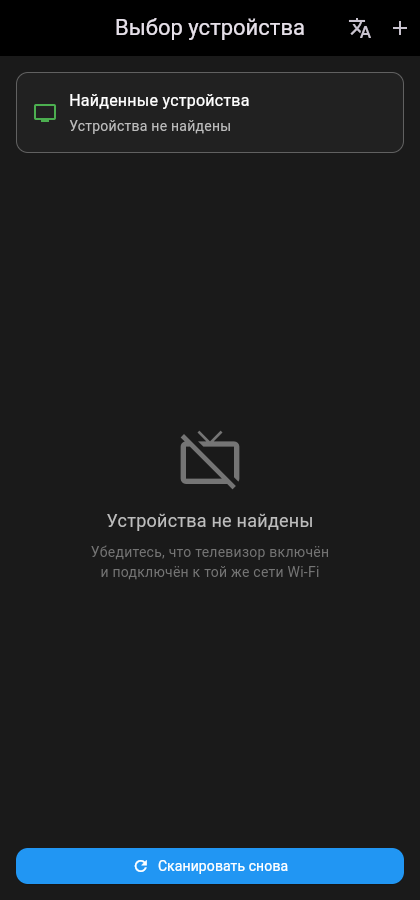
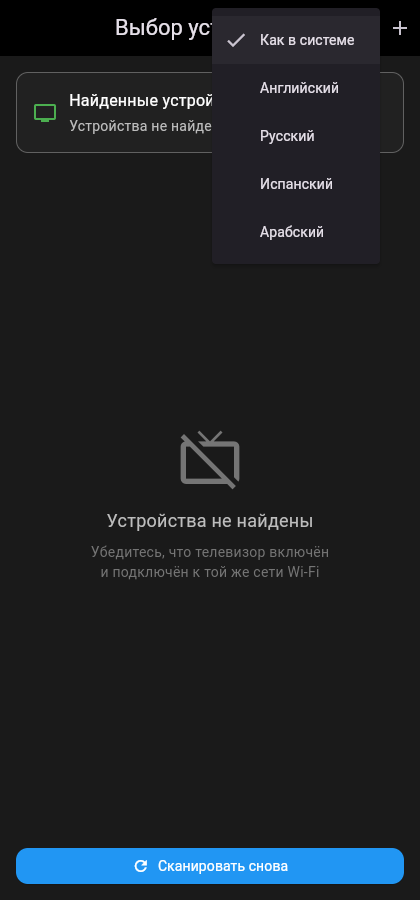
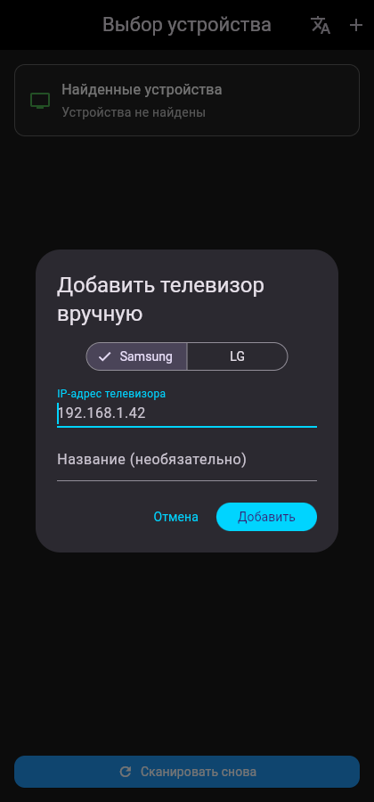

# Пульт для Smart TV

> Универсальный пульт на Flutter для телевизоров Samsung Tizen и LG WebOS: поиск в сети, управление и переподключение без штатного пульта.

[English README](README.md) · [Гайд по настройке](docs/ru/setup.md) · [Политика конфиденциальности](docs/ru/privacy.md)

[](https://github.com/mazen-salah/Smart-TV-Remote-Control/actions/workflows/ci.yml)
[](https://github.com/mazen-salah/Smart-TV-Remote-Control/releases/latest)
[](LICENSE)


---

## Скриншоты

| Выбор устройства | Меню языка | Ручное добавление по IP |
| :---: | :---: | :---: |
|  |  |  |

_Снимки сделаны с web-сборки того же кода: экран пульта требует настоящего телевизора._

---

## Установка

- **Android:** скачайте подписанный APK из [последнего релиза](https://github.com/mazen-salah/Smart-TV-Remote-Control/releases/latest).
  Большинству телефонов подходит сборка `arm64-v8a`; если не уверены — берите `universal`.
  При первой установке система попросит разрешить установку из этого источника.
- **iOS:** в TestFlight пока нет. Соберите из исходников — см. [быстрый старт](#быстрый-старт).

Пошаговая инструкция с сопряжением, ручным добавлением по IP и разбором частых проблем —
в [гайде по настройке](docs/ru/setup.md).

---

## Возможности

### Поиск телевизора
- Параллельный обход SSDP (UPnP) и Bonjour/mDNS. mDNS идёт через системный браузер служб,
  поэтому работает на iOS без права Apple на multicast, а на Android — без дополнительных
  разрешений; на время SSDP-обхода приложение держит `MulticastLock`.
- Объявления AirPlay и Cast тоже проверяются на производителя: телевизор LG или Samsung,
  который представляется только ими, всё равно найдётся, а Apple TV и Chromecast отсеиваются.
- Ручной ввод IP на случай, когда телевизор не отвечает на широковещательные запросы.
- Память известных телевизоров: ранее сопряжённые модели запоминаются и подключаются
  автоматически при следующем запуске.

### Соединение
- Реальное состояние сети через `connectivity_plus` (без опроса DNS).
- Штатный heartbeat WebSocket через `pingInterval` (без ручных таймеров).
- Wake-on-LAN: если известный телевизор отказал в подключении, приложение отправляет
  magic-пакет и повторяет попытку один раз.
- Токен сопряжения Samsung хранится локально — запрос «Разрешить» на телевизоре появляется
  только в первый раз.

### Марки
- **Samsung Tizen** — клиент WebSocket v2 (`wss://`) в `lib/services/samsung/samsung_tv_service.dart`,
  проверен на реальном железе.
- **LG webOS** — клиент WebSocket в `lib/services/lg/lg_tv_service.dart`: защищённый порт,
  который требует новый firmware (2023+), подписанный манифест сопряжения LG, отдельный сокет
  указателя для навигации, цветные и цифровые клавиши, `media.controls` для транспорта.
  **На реальном телевизоре LG пока не проверено**. Если он у вас есть —
  [пришлите отчёт о тесте](https://github.com/mazen-salah/Smart-TV-Remote-Control/issues?q=is%3Aissue+label%3A%22help+wanted%22).
- **Ручной ввод IP** — добавление Samsung или LG по адресу, если поиск не нашёл телевизор.

### Интерфейс
- Тачпад для управления курсором на LG webOS: свайп двигает курсор, касание — клик.
  Кнопка тачпада в шапке пульта подменяет крестовину, высота экрана не меняется;
  на Samsung её нет — в протоколе Tizen нет указателя.
- Тёмная тема Material 3.
- Тактильный отклик на каждое нажатие.
- Подписи `Semantics` у каждой кнопки (совместимо со скринридерами).
- Языки: английский, **русский**, испанский, арабский. Язык берётся из системы, а в меню
  приложения (иконка перевода в шапке экрана выбора устройства) его можно задать вручную —
  выбор сохраняется между запусками.
- Название в лаунчере переведено на обеих платформах: `values-ru/strings.xml` на Android
  и `InfoPlist.strings` в iOS-проекте.

---

## Поддерживаемые телевизоры

| Марка | Модели | Протокол | Замечания |
| --- | --- | --- | --- |
| Samsung | 2016+ Tizen | WebSocket v2 (`wss://<ip>:8002`) | Токен сохраняется после первого «Разрешить». Проверено. |
| LG | webOS 3.0+ | WebSocket (`wss://<ip>:3001`, откат на `ws://<ip>:3000`) | Ключ клиента и сертификат телевизора сохраняются поверх TLS; модели до 2018 года, которые умеют только открытый порт, спрашивают подтверждение при каждом подключении. Нужна проверка на железе. Не разведены: выбор источника, tools, guide, more, record. |

Sony Bravia, Roku, Android TV и другие пока не поддерживаются — см. [планы](#планы-и-известные-ограничения).

---

## Быстрый старт

```bash
git clone https://github.com/mazen-salah/Smart-TV-Remote-Control.git
cd Smart-TV-Remote-Control
flutter pub get
flutter run
```

Требования:

- Flutter `>= 3.47.0` (в Android-проекте Gradle 9.3 и AGP 9.1, со старыми Gradle-плагинами Flutter они не собираются)
- Телефон и телевизор в одной сети Wi-Fi / VLAN
- Если новая версия Android сама спросит про доступ к **локальной сети** — разрешите его

---

## Архитектура

```
┌─────────────────────────────────────────────────────┐
│  UI  (screens, widgets)                             │
│   - DeviceSelectionScreen                           │
│   - RemoteScreen                                    │
│   - ManualIpDialog                                  │
└───────────────▲─────────────────────────────────────┘
                │ BlocBuilder / BlocListener
┌───────────────┴─────────────────────────────────────┐
│  Слой bloc    (lib/blocs/)                          │
│   - TvConnectionBloc                                │
│   - DeviceDiscoveryBloc                             │
│   - ConnectivityCubit, LocaleCubit                  │
└───────────────▲─────────────────────────────────────┘
                │ вызовы
┌───────────────┴─────────────────────────────────────┐
│  Слой репозиториев  (lib/core/repositories/)        │
│   - TvRepository   (выбирает SamsungTV или LGTV по  │
│                     производителю, владеет сессией) │
│   - KnownTvsStorage / TvTokenStorage                │
│   - LocaleStorage  (выбранный язык)                 │
│   - WakeOnLanService  (lib/core/services/)          │
└───────────────▲─────────────────────────────────────┘
                │ делегирует
┌───────────────┴─────────────────────────────────────┐
│  Слой сервисов  (lib/services/, lib/implementations)│
│   - samsung/samsung_tv_service.dart (WSS v2)        │
│   - lg/lg_tv_service.dart           (webOS wss)     │
│   - upnp/ssdp_discovery_service.dart (SSDP)         │
│   - mdns/bonjour_discovery_service.dart (Bonjour)   │
└───────────────▲─────────────────────────────────────┘
                │ TCP / UDP / WebSocket
┌───────────────┴─────────────────────────────────────┐
│  Телевизор  (Samsung Tizen / LG WebOS / другой)     │
└─────────────────────────────────────────────────────┘
```

DI собирается в `lib/di/service_locator.dart` на `get_it`. Bloc-и зависят от репозиториев,
репозитории — от сервисов. UI никогда не обращается к сервису напрямую.

Сами протоколы (сопряжение Samsung WebSocket v2, регистрация и сокет указателя LG webOS,
поиск через SSDP и Bonjour) разобраны в [docs/protocols.md](docs/protocols.md) (по-английски).

---

## Частые проблемы

**Телевизор не находится**
- Убедитесь, что телефон и телевизор в одной сети Wi-Fi (один SSID) и это не изолированная
  гостевая сеть или VLAN для IoT.
- Если Android спросит про доступ к локальной сети, разрешите его — без этого mDNS и UPnP молча не работают.
- Попробуйте **добавить вручную по IP** на экране выбора устройства. Адрес телевизора обычно
  лежит в *Настройки → Сеть → Состояние сети*.

**На Samsung не появляется запрос «Разрешить»**
- Возможно, токен вашего телефона уже сохранён, но заблокирован. На телевизоре:
  *Настройки → Общие → Менеджер внешних устройств → Менеджер подключения устройств →
  Уведомление о доступе* → **Только при первом подключении**, затем удалите телефон из
  *Списка устройств* и подключитесь снова.
- Очистите данные приложения, чтобы сбросить сохранённый токен и пройти сопряжение заново.

**Не подключается после того, как телевизор ушёл в сон**
- Для этого есть Wake-on-LAN. На телевизоре включите *Настройки → Общие → Сеть →
  Дополнительные настройки → Включение по мобильному устройству*. MAC-адрес приложение
  сохраняет при первом подключении и отправит magic-пакет при следующей попытке.
- Если WoL не помогает, скорее всего телевизор в другой подсети — magic-пакеты через
  маршрутизаторы не проходят.

Подробный разбор, включая сопряжение LG и ручное добавление, — в [гайде по настройке](docs/ru/setup.md).

---

## Планы и известные ограничения

Каждый пункт ведётся отдельным issue; если что-то интересует — берите в работу.

- Проверка LG WebOS на реальном железе — нужна помощь
- Перехват аппаратных кнопок громкости (Android `MediaSession` / iOS `MPRemoteCommandCenter`) — не сделано
- Запуск приложений (Netflix, YouTube, Disney+ по deeplink) — протокол умеет, UI нет
- Sony Bravia (IRCC-IP) и Roku (ECP) — не реализовано
- Раздача через iOS TestFlight — не настроена

Известное ограничение: переподключение в фоне на iOS работает по возможности, система может
приостановить сокет.

---

## Участие

Pull request'ы приветствуются. Порядок настройки, стиль кода и соглашение о коммитах —
в [CONTRIBUTING.md](CONTRIBUTING.md), правила общения — в [CODE_OF_CONDUCT.md](CODE_OF_CONDUCT.md).
Об уязвимостях — через [SECURITY.md](SECURITY.md). Приложение не собирает данных:
см. [PRIVACY.md](PRIVACY.md) и [русский пересказ](docs/ru/privacy.md).

Если у вас телевизор, который приложение пока не поддерживает, самый полезный вклад —
issue с маркой, моделью и годом firmware.

## Лицензия

MIT — см. [LICENSE](LICENSE).
